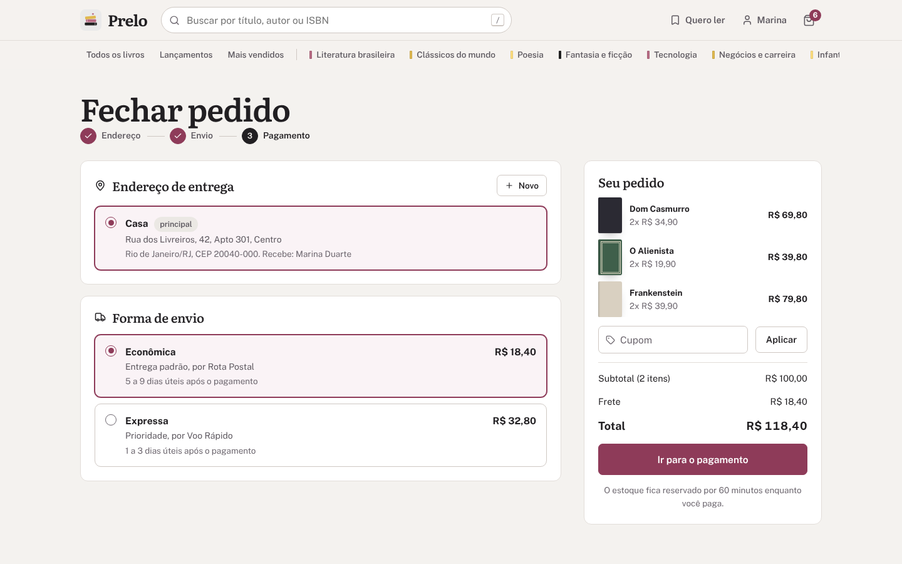
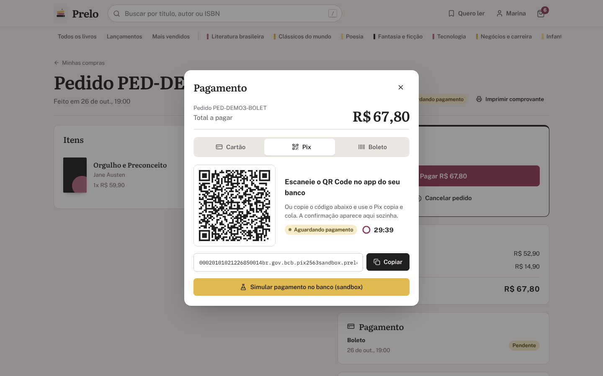
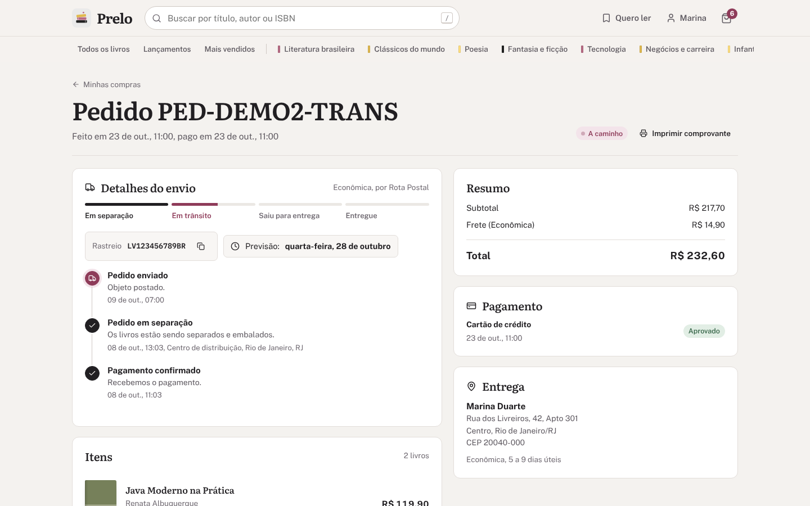
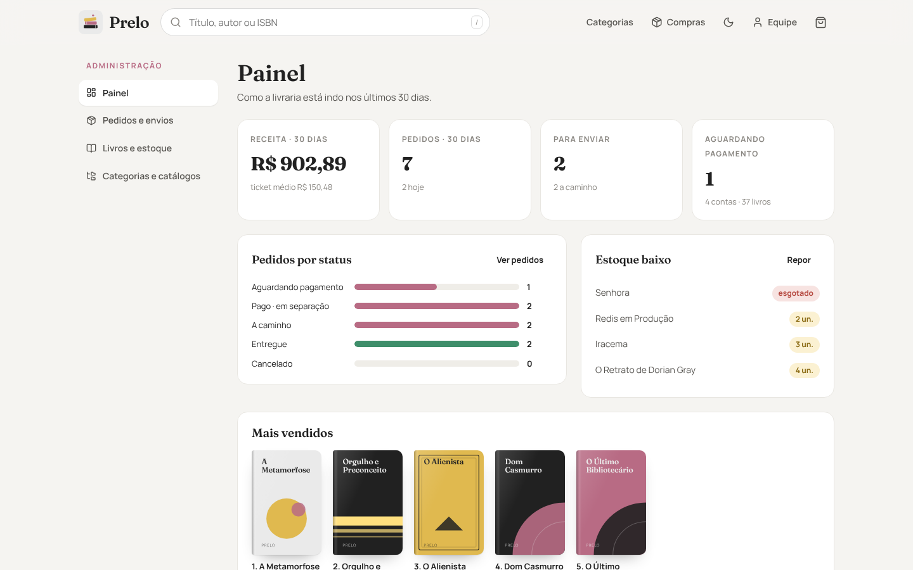
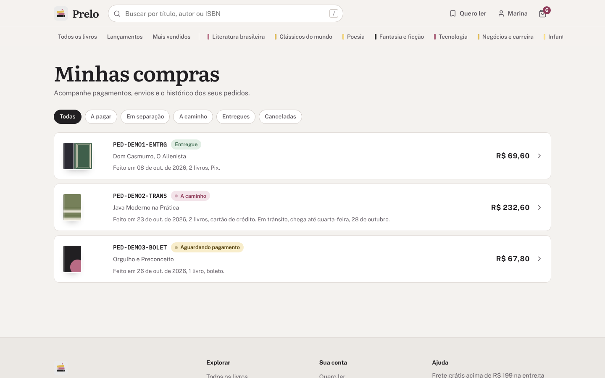

<p align="center">
  
</p>

<h1 align="center">Prelo<br><sub><sup><sup><sub>Copyright (©) 2026 Clara Portes</sub></sup></sup></sub></h1>

<p align="center">
  Livraria online completa: vitrine com catálogos e categorias, busca sem acentos, carrinho, checkout com frete por CEP, janela de pagamento com cartão, Pix e boleto, aba de compras e rastreio do envio, além de um painel para a livraria.<br>
  Roda em PostgreSQL, MySQL, SQL Server ou Oracle com o mesmo código. Pronto para usar, estudar ou adaptar.
</p>

<p align="center">
  Java 21 · Spring Boot 4.1 · Spring Security + JWT · JPA / Hibernate 7 · Flyway · Redis 7 · React 19 · Vite · PostgreSQL · MySQL · SQL Server · Oracle · Docker Compose · JUnit
</p>

---

> **Manual completo:** [`Manual-Prelo.pdf`](Manual-Prelo.pdf) explica a instalação, cada tela da loja e da administração, a janela de pagamento, o envio, a arquitetura, a segurança, a API, a configuração, os testes e a solução de problemas, passo a passo (cópia em [`docs/`](docs/Manual-Prelo.pdf)).

> **Banco de dados:** [`Banco-de-Dados-Prelo.pdf`](Banco-de-Dados-Prelo.pdf) traz o diagrama de relacionamentos, todas as tabelas com campos, tipos e chaves, os tipos equivalentes em cada um dos quatro bancos, as máquinas de estado, as regras que a arquitetura do banco deve seguir e como preparar PostgreSQL, MySQL, SQL Server e Oracle.

<p align="center">
  
</p>

## O que o Prelo faz

- **Catálogos e categorias:** vitrines curadas com ordem própria (Mais vendidos, Lançamentos, Clássicos essenciais...) e oito categorias com contagem de livros. Tudo em trilhos que deslizam com o mouse ou o dedo.
- **Busca de verdade:** título, subtítulo, autor, editora e ISBN, sem diferenciar acentos nem maiúsculas. Filtros por categoria, formato, faixa de preço e estoque, com seis ordenações e paginação.
- **Página do livro:** capa gerada na paleta do projeto, sinopse, ficha técnica, estoque em tempo real, cálculo de frete pelo CEP e sugestões da mesma estante.
- **Carrinho que acompanha você:** funciona sem login (fica no navegador) e é somado ao da conta quando você entra. Gaveta lateral, barra de frete grátis e cupons.
- **Checkout em três passos:** endereço (com preenchimento pelo CEP), forma de envio com preço e prazo por região e revisão com cupom. O estoque fica reservado por 60 minutos enquanto você paga.
- **Janela de pagamento:** cartão de crédito em até 6x sem juros, Pix com QR Code, copia e cola e contagem regressiva, ou boleto com linha digitável. O número do cartão vira um token de uso único e nunca é gravado.
- **Minhas compras e detalhes de envio:** lista com filtros por status e, em cada pedido, a barra de progresso, o código de rastreio, a previsão de entrega e a linha do tempo completa.
- **Administração:** painel com receita, ticket médio, pedidos por status, estoque baixo e mais vendidos; pedidos e envios (postar, saiu para entrega, entregue); livros e estoque; categorias e catálogos.
- **Interface fluida:** transições suaves, microinterações, capas em 3D ao passar o mouse, tema claro e escuro e layout pensado para o celular.

<p align="center">
  
</p>

## Arquitetura


| Serviço | Tecnologia | Responsabilidade |
|---|---|---|
| `web` | React 19, React Router 7, Vite, nginx | Loja, checkout, janela de pagamento, minhas compras, conta e administração. O nginx entrega a interface e repassa `/api` |
| `api` | Java 21, Spring Boot 4.1, Spring Security, Spring Data JPA, Hibernate 7, Flyway | API REST, autenticação com JWT, regras de catálogo, carrinho, checkout, pagamentos, envio e administração |
| banco | PostgreSQL 16, MySQL 8.4, SQL Server 2022 ou Oracle 23ai | Fonte da verdade: contas, endereços, catálogo, carrinhos, pedidos, pagamentos e envios |
| `redis` | Redis 7 | Cache do catálogo, tokens de renovação de sessão, tokens de cartão, limite de tentativas de login e trava das tarefas agendadas |

### Como uma compra acontece

1. O carrinho é conferido item a item e o estoque é reservado com um `UPDATE ... WHERE stock_quantity >= :qtd` atômico, em ordem de id (dois clientes nunca levam o mesmo último exemplar).
2. O pedido nasce em **Aguardando pagamento** com uma cópia do endereço, dos preços e do frete, e prazo de 60 minutos para pagar.
3. Na janela de pagamento, o cartão vira um token de 10 minutos no Redis (só bandeira e 4 últimos dígitos), e o pagamento é enviado com uma `Idempotency-Key`: clicar duas vezes não cobra duas vezes.
4. Com o pagamento aprovado, o pedido vira **Pago**, nasce o envio em separação e os outros códigos Pix ou boleto pendentes deixam de valer.
5. A livraria posta o pedido, marca a saída para entrega e a entrega. Cada etapa entra na linha do tempo do cliente. Pedidos não pagos no prazo são cancelados a cada minuto e o estoque volta.

<p align="center">
  
  
</p>

## Quatro bancos, um código

O banco é escolhido por uma variável. As entidades JPA são as mesmas; cada banco tem a sua pasta de migrações Flyway com tabelas, colunas e nomes de restrições idênticos.

| `DB_VENDOR` | Versões | Migrações | Observações |
|---|---|---|---|
| `postgresql` (padrão) | 14 ou mais (CI no 16) | `db/migration/postgresql` | `TIMESTAMP WITH TIME ZONE`, `NUMERIC(12,2)` |
| `mysql` | 8.0 ou mais (CI no 8.4) | `db/migration/mysql` | InnoDB, `utf8mb4_0900_ai_ci`, `DATETIME(6)` em UTC |
| `sqlserver` | 2019 ou mais (CI no 2022) | `db/migration/sqlserver` | `NVARCHAR`, `DATETIMEOFFSET(6)` |
| `oracle` | 19c ou mais (CI no 23ai Free) | `db/migration/oracle` | `VARCHAR2(n CHAR)`, `NUMBER`, identidade `GENERATED BY DEFAULT ON NULL` |

Para trocar, mude `DB_VENDOR` no `.env` e rode o script de novo. O GitHub Actions roda a bateria inteira de testes de integração nos quatro bancos a cada push.

## Como rodar

Você só precisa do **Docker** com Docker Compose.

**Windows:** dê dois cliques em `iniciar.cmd`.

**Linux ou macOS:**

```bash
./iniciar.sh
```

Na primeira vez o script cria o arquivo `.env` com uma senha aleatória para o banco e uma chave aleatória para o JWT, sobe os contêineres (banco escolhido, Redis, API e interface) e abre **http://localhost:8080**.

| Endereço | O que é |
|---|---|
| http://localhost:8080 | Loja e administração |
| http://localhost:8080/api/docs | Documentação da API (Swagger) |
| http://localhost:8080/api/health | Saúde da API, do banco e do Redis |

Para rodar sem o script:

```bash
cp .env.example .env              # preencha DB_PASSWORD e JWT_SECRET
docker compose up -d --build
docker compose logs -f api        # acompanhar a API
```

Para usar outro banco, troque no `.env` (os dois valores iguais):

```bash
DB_VENDOR=oracle
COMPOSE_PROFILES=oracle
```

## Contas de demonstração

Todas usam a senha **`Prelo@2026`**. Elas existem só para testes, para qualquer pessoa entrar logo depois de baixar o projeto. Nomes, e-mails, endereços, editoras, preços e ISBNs (prefixo 978-65-99999) são fictícios; os clássicos citados estão em domínio público.

| Papel | E-mail | O que pode fazer |
|---|---|---|
| Cliente | `leitora@prelo.dev` | Comprar, pagar, acompanhar os pedidos e gerenciar endereços |
| Administração | `admin@prelo.dev` | Tudo, incluindo painel, pedidos, envios, livros, estoque, categorias e catálogos |

Para usar de verdade, suba com `APP_SEED_DEMO=false` num banco vazio e promova o seu usuário a administrador direto no banco (o manual mostra o comando para cada um dos quatro).

## Pagamentos

O projeto vem com um **sandbox**: nada sai da aplicação e nenhum código gerado paga algo de verdade (o Pix usa um identificador de sandbox e o boleto, um banco fictício).

| Cartão de teste | Resultado |
|---|---|
| `4111 1111 1111 1111` · `5555 5555 5555 4444` | Aprovado |
| `4000 0000 0000 0002` | Recusado pelo emissor |
| `4000 0000 0000 9995` | Limite insuficiente |

Pix e boleto ganham um botão **Simular pagamento** na janela de pagamento. Para um provedor real, implemente a interface `PaymentGateway` e desligue o sandbox com `PAYMENTS_SANDBOX=false`.

<p align="center">
  
  
</p>

## Usando a API

Entre com `POST /api/auth/login` e envie o `accessToken` no cabeçalho `Authorization: Bearer <token>`. O token vale 15 minutos; a renovação usa um cookie HttpOnly.

```bash
# entrar
TOKEN=$(curl -s -H "Content-Type: application/json" \
  -d '{"email":"leitora@prelo.dev","password":"Prelo@2026"}' \
  http://localhost:8080/api/auth/login | jq -r .accessToken)

# buscar sem acentos
curl "http://localhost:8080/api/books?q=memorias%20postumas&sort=price_asc"

# carrinho, checkout e pagamento com Pix
curl -H "Authorization: Bearer $TOKEN" -H "Content-Type: application/json" \
     -d '{"bookId":1,"quantity":1}' http://localhost:8080/api/cart/items
curl -H "Authorization: Bearer $TOKEN" -H "Content-Type: application/json" \
     -d '{"addressId":1,"shippingMethod":"EXPRESSA","couponCode":"BEMVINDO10"}' http://localhost:8080/api/orders
curl -H "Authorization: Bearer $TOKEN" -H "Content-Type: application/json" -H "Idempotency-Key: $(uuidgen)" \
     -d '{"method":"PIX"}' http://localhost:8080/api/orders/<codigo>/payments
```

| Rota | O que faz |
|---|---|
| `GET /api/home` · `/api/categories` · `/api/catalogs/{slug}` | Vitrine, categorias e catálogos curados |
| `GET /api/books` · `/api/books/{slug}` | Busca com filtros (`q`, `category`, `catalog`, `format`, `minPrice`, `maxPrice`, `inStock`, `sort`, `page`) e detalhe |
| `POST /api/shipping/quote` | Cotação de frete por CEP, peso e subtotal |
| `POST /api/auth/register` · `/login` · `/refresh` · `/logout` | Conta e sessão |
| `GET/POST/PATCH/DELETE /api/cart/...` | Carrinho, inclusive `POST /api/cart/merge` |
| `POST /api/checkout/quote` · `POST /api/orders` | Simulação com cupom e frete, e fechamento do pedido |
| `GET /api/orders` · `/api/orders/{codigo}` · `POST .../cancel` | Minhas compras, detalhes do envio e cancelamento |
| `POST /api/payments/card-tokens` · `POST /api/orders/{codigo}/payments` | Token do cartão e pagamento (cartão, Pix ou boleto) |
| `GET /api/account/addresses` · `PUT /api/account/profile` | Endereços e dados da conta |
| `/api/admin/...` | Painel, pedidos, envios, livros, estoque, categorias e catálogos |

Todos os erros seguem o formato Problem Details (RFC 9457) com um campo `code` estável, por exemplo `estoque_insuficiente` ou `cupom_invalido`.

## Configuração

As principais variáveis do `.env` (a lista completa está no manual):

| Variável | Padrão | O que faz |
|---|---|---|
| `APP_PORT` | `8080` | Porta no navegador |
| `DB_VENDOR` / `COMPOSE_PROFILES` | `postgresql` | Banco usado: `postgresql`, `mysql`, `sqlserver` ou `oracle` |
| `DB_NAME` / `DB_USER` / `DB_PASSWORD` | `prelo` / `prelo` / — | Banco de dados. A senha é gerada pelos scripts |
| `JWT_SECRET` | — | Chave do JWT (32 caracteres ou mais). Gerada pelos scripts; nunca publique a sua |
| `APP_SEED_DEMO` | `true` | Contas, livros e pedidos de exemplo num banco vazio |
| `PAYMENTS_SANDBOX` | `true` | Pagamentos simulados com cartões de teste |
| `APP_HTTPS` | `false` | Use `true` atrás de um proxy com HTTPS (cookie de sessão só por HTTPS) |
| `API_DOCS_ENABLED` | `true` | Liga ou desliga o Swagger |

<p align="center">
  
  
</p>

## Desenvolvimento e testes

Sem Docker, com Java 21, Maven, Node 22, Redis e um dos quatro bancos:

```bash
# API (PostgreSQL local por padrão; troque com DB_VENDOR)
cd backend
DB_PASSWORD=prelo JWT_SECRET=troque-por-uma-chave-com-32-caracteres mvn spring-boot:run

# interface (em outro terminal): http://localhost:5173, com /api repassado para a porta 8081
cd frontend
npm install
npm run dev
```

Os testes da API sobem a aplicação inteira contra um banco e um Redis de verdade (o Redis de teste usa o banco 15):

```bash
cd backend
DB_PASSWORD=prelo mvn verify                      # PostgreSQL
DB_VENDOR=mysql DB_PASSWORD=prelo mvn verify      # MySQL (o mesmo vale para sqlserver e oracle)

cd frontend && npm test
```

São 16 testes de integração na API (cadastro, sessão e limite de tentativas, busca sem acentos, filtros, frete, carrinho, checkout com cupom, cartão aprovado e recusado, Pix e boleto, idempotência, cancelamento com estorno, expiração de pedidos, estoque concorrente, permissões e validação do esquema pelo Hibernate) e testes de componentes na interface. O GitHub Actions roda a API nos quatro bancos, testa e compila a interface e constrói as imagens Docker a cada push.

### Estrutura

```text
backend/                  API Spring Boot (Java 21)
  src/main/java/.../      auth, account, catalog, cart, order, payment, shipping, admin, seed
  src/main/resources/
    db/migration/         uma pasta por banco: postgresql, mysql, sqlserver, oracle
  src/test/               testes de integração (JUnit + MockMvc)
frontend/                 interface React + Vite, servida pelo nginx no Docker
  src/pages/              vitrine, catálogo, livro, carrinho, checkout, compras, conta, administração
  src/components/         capas geradas, janela de pagamento, linha do tempo do envio, gaveta do carrinho
docs/                     manuais em PDF e imagens do README
.github/workflows/        integração contínua (testes nos quatro bancos)
```

### Componentes de terceiros

O Prelo depende de componentes com licenças próprias, que continuam valendo para cada um deles:

| Componente | Uso no projeto | Licença |
|---|---|---|
| [Spring Boot](https://spring.io/projects/spring-boot) e [Spring Security](https://spring.io/projects/spring-security) | API, segurança e JWT | Apache-2.0 |
| [Hibernate ORM](https://hibernate.org/orm/) | JPA | Apache-2.0 |
| [Flyway](https://github.com/flyway/flyway) | Migrações do banco | Apache-2.0 |
| [springdoc-openapi](https://springdoc.org/) | Documentação da API | Apache-2.0 |
| [React](https://react.dev/) e [React Router](https://reactrouter.com/) | Interface | MIT |
| [Vite](https://vite.dev/) | Build da interface | MIT |
| [Lucide](https://lucide.dev/) | Ícones da interface | ISC |
| [node-qrcode](https://github.com/soldair/node-qrcode) | QR Code do Pix | MIT |
| [Fraunces](https://github.com/undercasetype/Fraunces) e [Manrope](https://github.com/sharanda/manrope) | Fontes | SIL Open Font License 1.1 |
| Drivers JDBC do [PostgreSQL](https://jdbc.postgresql.org/), [MySQL](https://dev.mysql.com/downloads/connector/j/), [SQL Server](https://github.com/microsoft/mssql-jdbc) e [Oracle](https://www.oracle.com/database/technologies/appdev/jdbc.html) | Acesso aos bancos | BSD-2-Clause, GPLv2 com exceção FOSS, MIT e Oracle FUTC |

PostgreSQL, MySQL, SQL Server, Oracle e Redis rodam como serviços externos via Docker e não são redistribuídos neste repositório; cada um segue a licença da sua própria imagem (a do SQL Server roda na edição Developer, e a do Oracle, na edição Free).

## Licença

Copyright (©) 2026 Clara Portes

Este projeto é distribuído sob a licença [MIT](LICENSE). Você pode usar, copiar, modificar e redistribuir o código, inclusive para fins comerciais, desde que mantenha o aviso de copyright e o texto da licença.
