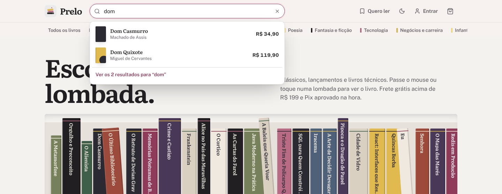
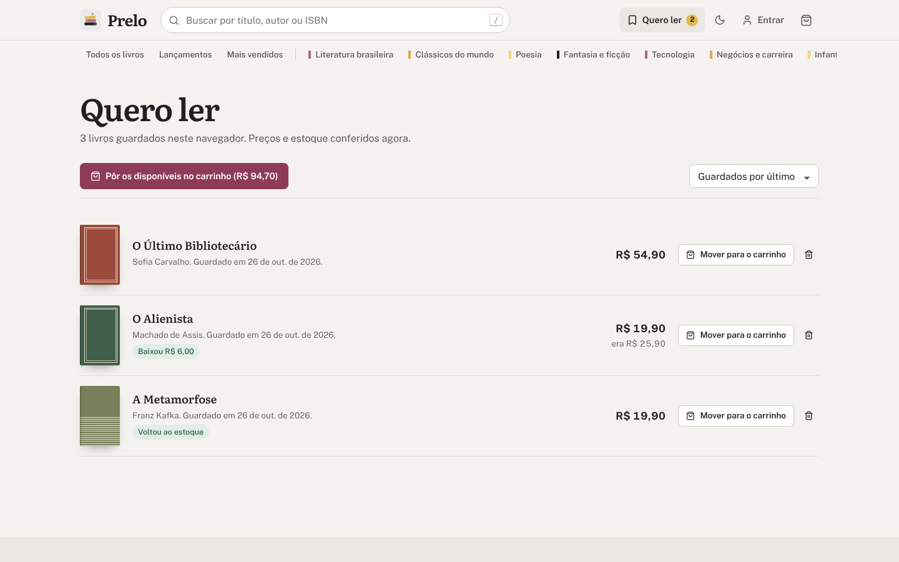
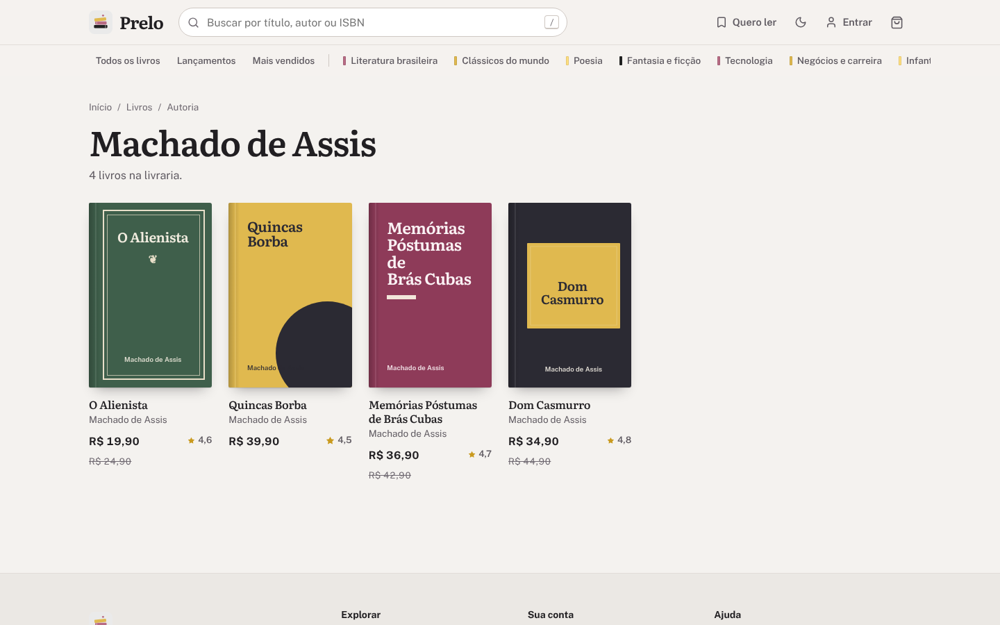
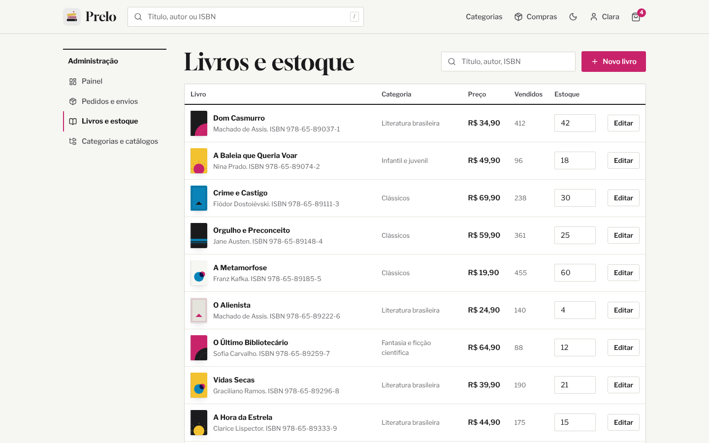
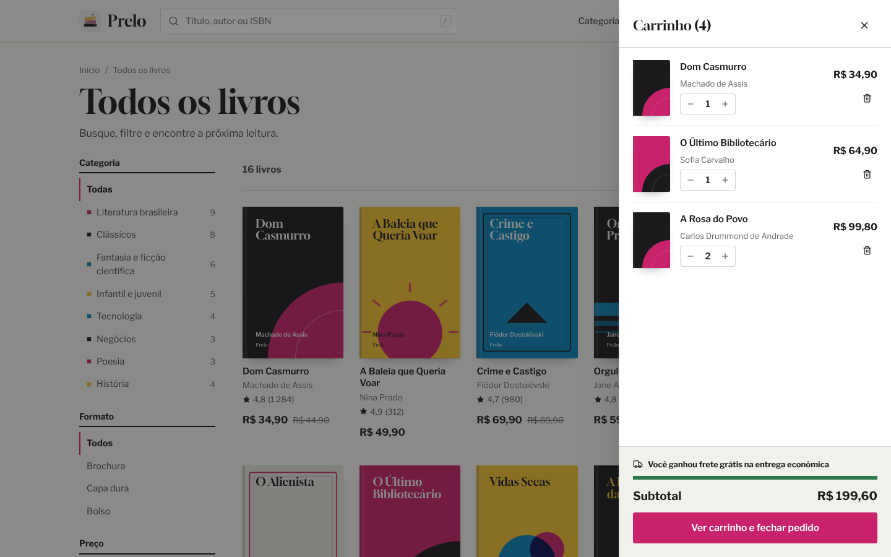
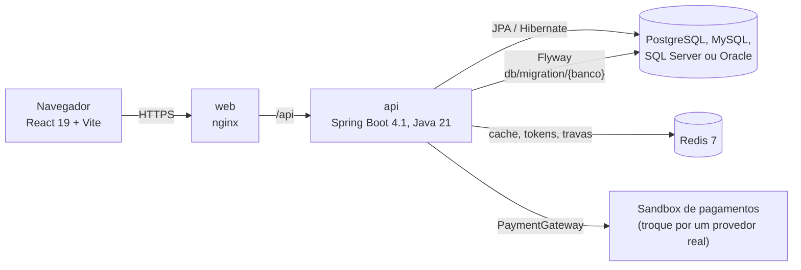

<p align="center">
  
</p>

<h1 align="center">Prelo<br><sub><sup><sup><sub>Copyright (©) 2026 Clara Portes</sub></sup></sup></sub></h1>

<p align="center">
  <b>Livraria online completa, da vitrine ao envio.</b><br>
  Você monta a vitrine e os catálogos; o Prelo cuida da busca, do carrinho, do checkout com frete por CEP, do pagamento com cartão, Pix ou boleto e do acompanhamento do envio, com o mesmo código rodando em PostgreSQL, MySQL, SQL Server ou Oracle.
</p>

<p align="center">
  <code>Java 21</code> · <code>Spring Boot 4.1</code> · <code>Spring Security + JWT</code> · <code>Hibernate 7</code> · <code>Flyway</code> · <code>React 19</code> · <code>Vite</code> · <code>PostgreSQL · MySQL · SQL Server · Oracle</code> · <code>Redis 7</code> · <code>Docker Compose</code> · <code>JUnit</code>
</p>

<p align="center">
  <a href="#como-rodar">Como rodar</a> ·
  <a href="Manual-Prelo.pdf">Manual técnico (PDF)</a> ·
  <a href="Banco-de-Dados-Prelo.pdf">Banco de dados (PDF)</a> ·
  <a href="#usando-a-api">API</a> ·
  <a href="#design-e-acessibilidade">Design</a> ·
  <a href="#licença">Licença</a>
</p>

<p align="center">
  
</p>

---

## Sumário

- [Visão geral](#visão-geral)
- [Novidades da versão 1.1](#novidades-da-versão-11)
- [Telas](#telas)
- [Arquitetura](#arquitetura)
- [Como rodar](#como-rodar)
- [Contas de demonstração](#contas-de-demonstração)
- [Pagamentos](#pagamentos)
- [Usando a API](#usando-a-api)
- [Configuração](#configuração)
- [Design e acessibilidade](#design-e-acessibilidade)
- [Desenvolvimento e testes](#desenvolvimento-e-testes)
- [Documentação em PDF](#documentação-em-pdf)
- [Parceria](#parceria)
- [Licença](#licença)

## Visão geral

O Prelo resolve o que toda livraria pequena precisa para vender pela internet sem depender de uma plataforma fechada: um catálogo fácil de navegar, um checkout que não perde o cliente no meio do caminho, pagamentos seguros e um lugar para acompanhar pedidos e estoque. Tudo num código aberto que roda no banco que a livraria já usa.

| | O que o Prelo faz |
|---|---|
| **Vitrine** | Estante de lombadas de verdade (a largura vem do número de páginas e a altura, do formato), catálogos curados com ordem própria (Mais vendidos, Lançamentos, Clássicos essenciais...) em trilhos que deslizam com o mouse ou o dedo, e oito categorias com contagem de livros. |
| **Busca** | Título, subtítulo, autor, editora e ISBN, sem diferenciar acentos nem maiúsculas, com sugestões enquanto você digita (capa, autoria e preço), navegação pelo teclado e buscas recentes. Filtros por categoria, formato, faixa de preço e estoque, seis ordenações e paginação. |
| **Livro** | Capa gerada pela própria interface, sinopse, ficha técnica e ficha catalográfica, estoque, cálculo de frete pelo CEP, tempo estimado de leitura, página da pessoa autora e sugestões da mesma estante. |
| **Carrinho** | Funciona sem login (fica no navegador) e é somado ao da conta quando você entra. Gaveta lateral, barra de frete grátis e cupons. |
| **Checkout** | Três passos: endereço preenchido pelo CEP, forma de envio com preço e prazo por região e revisão com cupom. O estoque fica reservado por 60 minutos enquanto você paga. |
| **Pagamento** | Cartão em até 6x sem juros, Pix com QR Code, copia e cola e contagem regressiva, ou boleto com linha digitável. O número do cartão vira um token de uso único e nunca é gravado. |
| **Pedidos** | Minhas compras com filtros por status e, em cada pedido, barra de progresso, código de rastreio, previsão de entrega, linha do tempo, comprar de novo e comprovante para imprimir. |
| **Quero ler** | Marcador em cada livro que guarda a lista no navegador e avisa quando o preço baixa ou o livro volta ao estoque, com um botão que move tudo o que está disponível para o carrinho. |
| **Administração** | Painel (receita, ticket médio, pedidos por status, estoque baixo e mais vendidos), pedidos e envios, livros e estoque, categorias e catálogos, com exportação em CSV. |
| **Quatro bancos** | As mesmas entidades JPA em PostgreSQL, MySQL, SQL Server ou Oracle, cada um com as próprias migrações Flyway e tabelas, colunas e restrições idênticas. |

## Novidades da versão 1.1

A 1.1 é uma revisão de design e de experiência de uso. Nenhuma tabela, rota da API ou regra de negócio mudou: basta atualizar e reconstruir as imagens.

- **Identidade tirada do logo.** A paleta sai da pilha de livros do logo: tinta grafite, **malva** (`#8E3B59`) para ações e **mostarda** (`#E0B94F`) para preços e destaques, sobre papel neutro. As capas geradas viraram capas de tecido e papel, com etiqueta, faixa, moldura e vinco da lombada.
- **Três vozes tipográficas.** As mesmas do Lume: Literata nos títulos e nos livros, Public Sans no texto e **IBM Plex Mono** só para identificadores (ISBN, pedido, rastreio, CEP, cupom) e para a ficha catalográfica. As três são auto-hospedadas.
- **Vitrine que parece livraria.** A página inicial abre com uma estante de lombadas, e uma barra de estantes logo abaixo do cabeçalho deixa as categorias a um clique.
- **Quero ler**, busca com sugestões, página de autoria, vistos por último, comprar de novo, comprovante para imprimir e atalhos de teclado (aperte `?`).
- **Administração** com exportação em CSV de pedidos e livros e filtros de estoque baixo, esgotados e fora da loja.
- **Correção.** A rolagem ao trocar de página e o menu da conta quebravam em navegadores em que `window.scrollTo` devolve uma Promise.
- **Documentação.** Manual técnico e documento do banco reescritos e diagramados de novo, agora com a fonte em HTML no repositório (`docs/fonte/`) para serem regenerados a cada versão.

## Telas

| | |
|---|---|
|  |  |
| **Livro** — preço, estoque, frete pelo CEP, sinopse e ficha catalográfica. | **Busca** — sugestões com capa, autoria e preço enquanto você digita. |
|  |  |
| **Checkout** — endereço pelo CEP, forma de envio e cupom. | **Pagamento** — Pix com QR Code, copia e cola e contagem regressiva. |
|  |  |
| **Envio** — progresso, rastreio, previsão de entrega e linha do tempo. | **Minhas compras** — todos os pedidos, filtrados por status. |
|  |  |
| **Quero ler** — avisa quando o preço baixa ou o livro volta. | **Autoria** — todos os livros de uma pessoa autora. |
|  |  |
| **Painel** — receita, ticket médio, pedidos por status e estoque baixo. | **Livros e estoque** — filtros de estoque, edição e exportação em CSV. |
|  |  |
| **Carrinho** — gaveta lateral com barra de frete grátis. | **Tema escuro** — a mesma estante, com malva e mostarda mais claras. |

## Arquitetura



| Serviço | Linguagem | Responsabilidade |
|---|---|---|
| `web` | JavaScript (React 19, React Router 7, Vite) + nginx | Loja, checkout, janela de pagamento, minhas compras, conta e administração. O nginx entrega a interface e repassa `/api` |
| `api` | Java 21 (Spring Boot 4.1, Spring Security, Spring Data JPA, Hibernate 7, Flyway) | API REST, autenticação com JWT, catálogo, carrinho, checkout, pagamentos, envio e administração |
| banco | — | Fonte da verdade: contas, endereços, catálogo, carrinhos, pedidos, pagamentos e envios. PostgreSQL 16, MySQL 8.4, SQL Server 2022 ou Oracle 23ai |
| `redis` | — | Cache do catálogo, tokens de renovação de sessão, tokens de cartão, limite de tentativas de login e trava das tarefas agendadas |

### Como uma compra acontece

1. O carrinho é conferido item a item e o estoque é reservado com um `UPDATE ... WHERE stock_quantity >= :qtd` atômico, em ordem de id. Dois clientes nunca levam o mesmo último exemplar.
2. O pedido nasce em Aguardando pagamento, com uma cópia do endereço, dos preços e do frete, e tem 60 minutos para ser pago.
3. Na janela de pagamento, o cartão vira um token de 10 minutos no Redis (só bandeira e 4 últimos dígitos), e o pagamento vai com uma `Idempotency-Key`. Clicar duas vezes não cobra duas vezes.
4. Com o pagamento aprovado, o pedido vira Pago, o envio nasce em separação e os outros códigos Pix ou boleto pendentes deixam de valer.
5. A livraria posta o pedido, marca a saída para entrega e a entrega. Cada etapa entra na linha do tempo do cliente. A cada minuto, os pedidos não pagos no prazo são cancelados e o estoque volta.

O modelo de dados completo — diagrama de relacionamentos, cada tabela com campos, tipos e chaves, os tipos equivalentes nos quatro bancos, máquinas de estado e regras do esquema — está em [`Banco-de-Dados-Prelo.pdf`](Banco-de-Dados-Prelo.pdf).

### Segurança

| Regra | Como funciona |
|---|---|
| Senhas | BCrypt (custo 11); login com e-mail inexistente leva o mesmo tempo que um com senha errada |
| Sessão | Token de acesso JWT HS256 de 15 minutos, só na memória do navegador. A renovação usa um cookie HttpOnly, SameSite Strict, e o Redis guarda só o hash do token, que gira a cada uso |
| Tentativas | 5 senhas erradas por e-mail bloqueiam o login por 15 minutos |
| Permissões | `/api/admin/**` só para `ADMIN`; pedidos e pagamentos de outra conta respondem 404 |
| Cartão | Vira um token de uso único; o número nunca é gravado |
| Cabeçalhos | CSP, X-Frame-Options, nosniff e Referrer-Policy na API e no nginx |

## Como rodar

Você só precisa do **Docker** com Docker Compose.

**Windows:** dê dois cliques em `iniciar.cmd`.

**Linux ou macOS:**

```bash
./iniciar.sh
```

Na primeira vez o script cria o arquivo `.env` com uma senha aleatória para o banco e uma chave aleatória para o JWT, sobe os contêineres (banco escolhido, Redis, API e interface) e abre **http://localhost:8080**.

| Endereço | O que é |
|---|---|
| http://localhost:8080 | Loja e administração |
| http://localhost:8080/api/docs | Documentação da API (Swagger) |
| http://localhost:8080/api/health | Saúde da API, do banco e do Redis |

Para rodar sem o script:

```bash
cp .env.example .env              # preencha DB_PASSWORD e JWT_SECRET
docker compose up -d --build
docker compose logs -f api        # acompanhar a API
```

| Para | Comando |
|---|---|
| Parar (os dados ficam nos volumes) | `docker compose down` |
| Atualizar depois de baixar uma versão nova | `docker compose up -d --build` |
| Abrir o terminal do banco (PostgreSQL) | `docker compose exec postgresql psql -U prelo` |
| Abrir o terminal do Redis | `docker compose exec redis redis-cli` |
| Apagar tudo, inclusive os dados | `docker compose down -v` |

> Atualizando da 1.0? Rode `docker compose up -d --build`. O esquema do banco não mudou; só a imagem `web` ganhou a nova interface.

## Contas de demonstração

As duas usam a senha **`Prelo@2026`**. Elas existem só para testes, para qualquer pessoa entrar logo depois de baixar o projeto. Nomes, e-mails, endereços, editoras, preços e ISBNs (prefixo 978-65-99999) são fictícios; os clássicos citados estão em domínio público.

| Papel | E-mail | O que pode fazer |
|---|---|---|
| Cliente | `leitora@prelo.dev` | Comprar, pagar, acompanhar os pedidos e gerenciar endereços |
| Administração | `admin@prelo.dev` | Tudo, incluindo painel, pedidos, envios, livros, estoque, categorias e catálogos |

Cupons de demonstração: `BEMVINDO10` (10%), `LEIA20` (R$ 20 acima de R$ 150) e `CLASSICOS15` (15% acima de R$ 100).

Para usar de verdade:

1. Suba com `APP_SEED_DEMO=false` num banco vazio.
2. Se não for testar pagamentos simulados, defina `PAYMENTS_SANDBOX=false` e implemente um provedor real (veja [Pagamentos](#pagamentos)).
3. Crie a sua conta pela tela **Criar conta** e promova-a a administração direto no banco:

   ```sql
   UPDATE app_user SET user_role = 'ADMIN' WHERE email = 'voce@sualivraria.com.br';
   ```

4. Saia e entre de novo para o novo papel valer no token.

O manual traz o checklist completo para produção (HTTPS, segredos, Swagger e backup).

## Pagamentos

O projeto vem com um sandbox: nada sai da aplicação e nenhum código gerado paga nada (o Pix usa um identificador de sandbox e o boleto, um banco fictício).

| Forma | Como testar | Observação |
|---|---|---|
| Cartão | `4111 1111 1111 1111` ou `5555 5555 5555 4444` | Aprovado. Até 6x sem juros |
| Cartão | `4000 0000 0000 0002` | Recusado pelo emissor |
| Cartão | `4000 0000 0000 9995` | Limite insuficiente |
| Pix | Botão **Simular pagamento** na janela | QR Code, copia e cola e contagem regressiva |
| Boleto | Botão **Simular pagamento** na janela | Linha digitável de um banco fictício |

Qualquer nome, validade futura e CVV de 3 dígitos (4 no Amex) funcionam. Para um provedor real, implemente a interface `PaymentGateway`, registre-a no lugar do `SandboxGateway` e desligue o sandbox:

```bash
# no .env
PAYMENTS_SANDBOX=false
docker compose up -d --build api
```

O cartão nunca chega ao banco: a interface troca o número por um token de 10 minutos no Redis, e o pedido guarda só a bandeira e os 4 últimos dígitos.

## Usando a API

Entre com `POST /api/auth/login` e envie o `accessToken` no cabeçalho `Authorization: Bearer <token>`. O token vale 15 minutos; quando ele expira, `POST /api/auth/refresh` usa o cookie HttpOnly para gerar outro.

```bash
# entrar
TOKEN=$(curl -s -H "Content-Type: application/json" \
  -d '{"email":"leitora@prelo.dev","password":"Prelo@2026"}' \
  http://localhost:8080/api/auth/login | jq -r .accessToken)

# buscar sem acentos
curl "http://localhost:8080/api/books?q=memorias%20postumas&sort=price_asc"

# carrinho, checkout e pagamento com Pix
curl -H "Authorization: Bearer $TOKEN" -H "Content-Type: application/json" \
     -d '{"bookId":1,"quantity":1}' http://localhost:8080/api/cart/items
curl -H "Authorization: Bearer $TOKEN" -H "Content-Type: application/json" \
     -d '{"addressId":1,"shippingMethod":"EXPRESSA","couponCode":"BEMVINDO10"}' http://localhost:8080/api/orders
curl -H "Authorization: Bearer $TOKEN" -H "Content-Type: application/json" -H "Idempotency-Key: $(uuidgen)" \
     -d '{"method":"PIX"}' http://localhost:8080/api/orders/<codigo>/payments
```

| Rota | O que faz |
|---|---|
| `GET /api/home` · `/api/categories` · `/api/catalogs/{slug}` | Vitrine, categorias e catálogos curados |
| `GET /api/books` · `/api/books/{slug}` | Busca com filtros (`q`, `category`, `catalog`, `format`, `minPrice`, `maxPrice`, `inStock`, `sort`, `page`) e detalhe |
| `POST /api/shipping/quote` | Cotação de frete por CEP, peso e subtotal |
| `POST /api/auth/register` · `/login` · `/refresh` · `/logout` | Conta e sessão |
| `GET/POST/PATCH/DELETE /api/cart/...` | Carrinho, inclusive `POST /api/cart/merge` |
| `POST /api/checkout/quote` · `POST /api/orders` | Simulação com cupom e frete, e fechamento do pedido |
| `GET /api/orders` · `/api/orders/{codigo}` · `POST .../cancel` | Minhas compras, detalhes do envio e cancelamento |
| `POST /api/payments/card-tokens` · `POST /api/orders/{codigo}/payments` | Token do cartão e pagamento (cartão, Pix ou boleto) |
| `GET /api/account/addresses` · `PUT /api/account/profile` | Endereços e dados da conta |
| `/api/admin/...` | Painel, pedidos, envios, livros, estoque, categorias e catálogos |

Todos os erros seguem o formato Problem Details (RFC 9457), com um campo `code` estável, por exemplo `estoque_insuficiente` ou `cupom_invalido`. A referência completa, com esquemas de entrada e saída, fica em `/api/docs` (Swagger) e no capítulo de API do manual.

## Configuração

As principais variáveis do `.env` (a lista completa está no manual):

| Variável | Padrão | O que faz |
|---|---|---|
| `APP_PORT` | `8080` | Porta no navegador |
| `DB_VENDOR` / `COMPOSE_PROFILES` | `postgresql` | Banco usado: `postgresql`, `mysql`, `sqlserver` ou `oracle` |
| `DB_NAME` / `DB_USER` / `DB_PASSWORD` | `prelo` / `prelo` / — | Banco de dados. A senha é gerada pelos scripts |
| `JWT_SECRET` | — | Chave do JWT (32 caracteres ou mais). Gerada pelos scripts; nunca publique a sua |
| `APP_SEED_DEMO` | `true` | Contas, livros e pedidos de exemplo num banco vazio |
| `PAYMENTS_SANDBOX` | `true` | Pagamentos simulados com cartões de teste |
| `APP_HTTPS` | `false` | Use `true` atrás de um proxy com HTTPS (cookie de sessão só por HTTPS) |
| `APP_CORS_ORIGINS` | `http://localhost:8080` | Endereços que podem chamar a API pelo navegador |
| `API_DOCS_ENABLED` | `true` | Liga ou desliga o Swagger |

### Escolher o banco

O banco é escolhido no `.env`. Os dois valores precisam ser iguais (os scripts corrigem sozinhos):

```bash
DB_VENDOR=oracle
COMPOSE_PROFILES=oracle
```

| `DB_VENDOR` | Versões | Migrações | Observações |
|---|---|---|---|
| `postgresql` (padrão) | 14 ou mais (CI no 16) | `db/migration/postgresql` | `TIMESTAMP WITH TIME ZONE`, `NUMERIC(12,2)` |
| `mysql` | 8.0 ou mais (CI no 8.4) | `db/migration/mysql` | InnoDB, `utf8mb4_0900_ai_ci`, `DATETIME(6)` em UTC |
| `sqlserver` | 2019 ou mais (CI no 2022) | `db/migration/sqlserver` | `NVARCHAR`, `DATETIMEOFFSET(6)` |
| `oracle` | 19c ou mais (CI no 23ai Free) | `db/migration/oracle` | `VARCHAR2(n CHAR)`, `NUMBER`, identidade `GENERATED BY DEFAULT ON NULL` |

Cada banco guarda os dados no próprio volume: trocar `DB_VENDOR` começa uma loja nova, e voltar ao banco anterior traz os dados dele de volta.

## Design e acessibilidade

A interface não usa framework de CSS: tudo sai de tokens em `frontend/src/styles/tokens.css`, com tema claro e escuro trocados por `data-theme`. A paleta é tirada do próprio logo, a pilha de livros.

| Papel | Claro | Escuro | Uso |
|---|---|---|---|
| Papel | `#F4F2EF` | `#19171A` | Fundo das páginas |
| Superfície | `#FFFFFF` | `#222024` | Cartões, gaveta do carrinho e janelas |
| Tinta | `#211F22` Grafite | `#EEEAEC` | Texto e títulos |
| Assinatura | `#8E3B59` Malva | `#DB8CA6` | Botões, links, foco e seleção |
| Destaque | `#E0B94F` Mostarda | `#E8C463` | Etiquetas de preço, cupons e selos |
| Estante | `#E6E1DB` | `#3A353B` | Fundo da estante de lombadas |
| Estados | `#3E6B4F` · `#A3352B` | `#7DBB94` · `#E88A7E` | Pagamento aprovado e em estoque · erros e cancelamentos |

**Tipografia:** Literata (títulos e livros) · Public Sans (interface) · IBM Plex Mono (ISBN, pedido, rastreio, CEP, cupom e ficha catalográfica). As três são auto-hospedadas em `frontend/public/fonts`, sem chamadas a serviços externos.

**Acessibilidade:** link "Pular para o conteúdo", foco visível em todos os controles (inclusive nas lombadas da estante), rótulos ARIA nas ações só com ícone, avisos lidos por leitores de tela (`aria-live`), sugestões da busca navegáveis pelas setas, `Esc` fechando menus e janelas, e animações desligadas com `prefers-reduced-motion`.

**Atalhos de teclado**

| Onde | Tecla | Ação |
|---|---|---|
| Loja | <kbd>/</kbd> | Buscar livros |
| Loja | <kbd>g</kbd> depois <kbd>i</kbd> | Ir para a vitrine |
| Loja | <kbd>g</kbd> depois <kbd>l</kbd> | Ir para Quero ler |
| Loja | <kbd>g</kbd> depois <kbd>c</kbd> | Ir para Minhas compras |
| Loja | <kbd>c</kbd> | Abrir o carrinho |
| Loja | <kbd>?</kbd> | Mostrar os atalhos |
| Busca | <kbd>↑</kbd> <kbd>↓</kbd> · <kbd>Enter</kbd> | Escolher uma sugestão e abrir |
| Menus e janelas | <kbd>Esc</kbd> | Fechar |

<p align="center">
  
</p>

## Desenvolvimento e testes

Sem Docker, com Java 21, Maven 3.9, Node 22, Redis 7 e um dos quatro bancos:

```bash
# API na porta 8081 (PostgreSQL local por padrão; troque com DB_VENDOR)
cd backend
DB_PASSWORD=prelo JWT_SECRET=troque-por-uma-chave-com-32-caracteres mvn spring-boot:run

# interface em outro terminal: http://localhost:5173, com /api repassado para a porta 8081
cd frontend
npm install
npm run dev
```

Os testes da API sobem a aplicação inteira contra um banco e um Redis reais (o Redis de teste usa o banco 15):

```bash
cd backend
DB_PASSWORD=prelo mvn verify                                       # PostgreSQL
DB_VENDOR=mysql DB_HOST=127.0.0.1 DB_PASSWORD=prelo mvn verify     # MySQL (o mesmo vale para sqlserver e oracle)

cd frontend && npm test                                            # Vitest
```

São 16 testes de integração na API (cadastro, sessão e limite de tentativas, busca sem acentos, filtros, frete, carrinho, checkout com cupom, cartão aprovado e recusado, Pix e boleto, idempotência, cancelamento com estorno, expiração de pedidos, estoque concorrente, permissões e validação do esquema pelo Hibernate) e 8 na interface (formatação de preços, descontos e status, slugs e capas geradas). O GitHub Actions roda a API nos quatro bancos, testa e compila a interface e constrói as imagens Docker a cada push.

### Estrutura

```text
backend/             API Spring Boot (Java 21)
  src/main/java/     auth, account, catalog, cart, order, payment, shipping, admin, seed
  src/main/resources/db/migration/   uma pasta por banco: postgresql, mysql, sqlserver, oracle
  src/test/          testes de integração (JUnit + MockMvc)
frontend/            interface React + Vite, servida pelo nginx no Docker
  src/pages/         vitrine, catálogo, livro, carrinho, checkout, compras, conta, administração
  src/components/    capas geradas, estante, janela de pagamento, linha do tempo do envio, gaveta do carrinho
  src/styles/        tokens de design, base, componentes e páginas
  public/fonts/      Literata, Public Sans e IBM Plex Mono (OFL)
docs/                manuais em PDF, imagens do README e fonte dos manuais (docs/fonte)
scripts/             criação do .env no Windows (usado pelo iniciar.cmd)
.github/workflows/   CI nos quatro bancos e atividade diária
```

### Como contribuir

1. Abra uma issue descrevendo a ideia ou o problema.
2. Crie uma branch a partir da `main` e envie um pull request.
3. Mudou o esquema? Crie a migração nas quatro pastas de `db/migration`, com os mesmos nomes de tabelas, colunas e restrições.
4. Mudou algo visível? Atualize as capturas em `docs/images` e regenere os PDFs.
5. Quando a mudança for feita em dupla, inclua a linha `Co-authored-by:` no commit para que as duas pessoas recebam o crédito.

## Documentação em PDF

| Documento | Conteúdo |
|---|---|
| [`Manual-Prelo.pdf`](Manual-Prelo.pdf) | Instalação, cada tela da loja e da administração, janela de pagamento, envio, arquitetura, segurança, API, configuração, testes e solução de problemas |
| [`Banco-de-Dados-Prelo.pdf`](Banco-de-Dados-Prelo.pdf) | Diagrama de relacionamentos, todas as tabelas com campos, tipos e chaves, os tipos equivalentes nos quatro bancos, máquinas de estado, regras do esquema e como preparar cada banco |

Cópias idênticas ficam em [`docs/`](docs). Os dois são gerados a partir de HTML e CSS em [`docs/fonte`](docs/fonte), na mesma identidade da interface:

```bash
pip install weasyprint==70.0
python docs/fonte/gerar_pdfs.py
```

## Parceria

Projeto desenvolvido em parceria com meu parceiro de projetos e de vida Erik Pimenta (@ravelroot).

O repositório oficial fica em [Violet-pixel/Online-Bookstore-Platform](https://github.com/Violet-pixel/Online-Bookstore-Platform).

### Componentes de terceiros

O Prelo inclui ou depende de componentes com licenças próprias, que continuam valendo para cada um deles:

| Componente | Uso no projeto | Licença |
|---|---|---|
| [Spring Boot](https://spring.io/projects/spring-boot) e [Spring Security](https://spring.io/projects/spring-security) | API, segurança e JWT | Apache-2.0 |
| [Hibernate ORM](https://hibernate.org/orm/) | JPA | Apache-2.0 |
| [Flyway](https://github.com/flyway/flyway) | Migrações do banco | Apache-2.0 |
| [springdoc-openapi](https://springdoc.org/) | Documentação da API | Apache-2.0 |
| [React](https://react.dev/) e [React Router](https://reactrouter.com/) | Interface | MIT |
| [Vite](https://vite.dev/) e [Vitest](https://vitest.dev/) | Build e testes da interface | MIT |
| [Lucide](https://lucide.dev/) | Ícones da interface | ISC |
| [node-qrcode](https://github.com/soldair/node-qrcode) | QR Code do Pix | MIT |
| [Public Sans](https://github.com/uswds/public-sans) | Fonte da interface | SIL Open Font License 1.1 |
| [Literata](https://github.com/googlefonts/literata) | Fonte dos títulos e dos livros | SIL Open Font License 1.1 |
| [IBM Plex Mono](https://github.com/IBM/plex) | Identificadores e ficha catalográfica | SIL Open Font License 1.1 |
| [Mermaid](https://mermaid.js.org/) | Diagrama de relacionamentos do manual do banco (só na geração) | MIT |
| [WeasyPrint](https://weasyprint.org/) | Geração dos manuais em PDF (só no desenvolvimento) | BSD-3-Clause |
| Drivers JDBC do [PostgreSQL](https://jdbc.postgresql.org/), [MySQL](https://dev.mysql.com/downloads/connector/j/), [SQL Server](https://github.com/microsoft/mssql-jdbc) e [Oracle](https://www.oracle.com/database/technologies/appdev/jdbc.html) | Acesso aos bancos | BSD-2-Clause, GPLv2 com exceção FOSS, MIT e Oracle FUTC |

PostgreSQL, MySQL, SQL Server, Oracle e Redis rodam como serviços externos via Docker e não são redistribuídos neste repositório; cada um segue a licença da sua própria imagem (a do SQL Server roda na edição Developer, e a do Oracle, na edição Free).

Os livros, autores, editoras e pedidos de demonstração são fictícios; os clássicos citados estão em domínio público.

## Licença

Copyright (©) 2026 Clara Portes

Este projeto é distribuído sob a licença [MIT](LICENSE). Você pode usar, copiar, modificar e redistribuir o código, inclusive para fins comerciais, desde que mantenha o aviso de copyright e o texto da licença.
